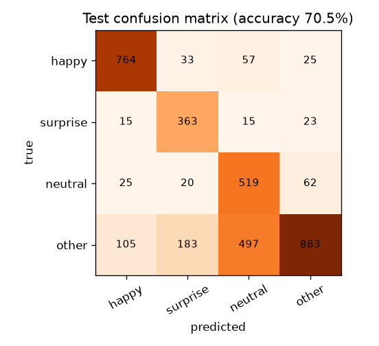

# Straight Face

A watch party where your face plays the game.

Up to four friends watch the same YouTube video in sync, talk on voice and video, and chat. Anyone can play, pause or seek. Each person's browser reads their own face locally, and that powers a **Don't Laugh** game, floating **auto reactions**, and a **Reaction Radar** recap that shows the exact seconds the room cracked up.

- Live app: _add the Vercel URL after deploying_
- Demo video: _add the link after recording_

## Problem

Watch parties are a video plus a chat box. Nothing reacts to the people actually watching.

## Users

Friends and classmates who watch things together while apart.

## Words used in this README

- **WebRTC**: a browser feature that sends voice and video straight between two people, without going through our server.
- **Mesh**: every person connects directly to every other person. That is why a room is capped at 4.
- **TURN server**: a relay used only when two people's networks block a direct connection.
- **Socket.IO**: a library that keeps a live two-way connection between the browser and the server, used for chat and sync.
- **MediaPipe**: Google's pretrained face-tracking library. It runs in the browser.
- **Blendshape**: a number from 0 to 1 for one facial movement, such as "mouth smile left".

## Features

| Feature | Status |
|---|---|
| Sign up, log in, create room with a 6-letter code, join by code or link, max 4 | Built, tested live |
| Synced YouTube playback, anyone can control, late joiners catch up, drift correction | Built, tested live |
| Chat stamped with video time; hides later messages after a rewind | Built |
| Voice and video mesh, mic and camera toggles, speaker ring, no-camera fallback | Built. Tested between two real browsers on one machine with fake cameras (`tests/browser/webrtc.mjs`, 36 of 37 runs connected). **Not yet tested on two physical devices or across networks.** |
| Face reading (smile, surprise) with per-person calibration | Built. Tested on fake webcam video of FER2013 faces. **Not yet tested on a live person.** |
| Don't Laugh round: calibrate, 5 s countdown, live, winner | Server rules fully tested. Played end to end in two real browsers with fake face videos: the smiling player was marked out and the other won. **Not yet played by real people.** |
| Manual emoji and face-triggered emoji floating over the video | Built |
| Reaction Radar heat strip, peaks, awards, past parties, sample party | Built, tested with seeded data |
| Video queue with voting (most votes plays next) | Built, tested live |
| Share a screen or browser tab (any website, with tab audio) | Built. Tested between real browsers, including a late joiner. |
| Play a local video or song (MP4, WebM, MP3, M4A, WAV and more) for everyone | Built. Tested with an MP4 and an MP3 between real browsers. |
| Custom-trained emotion model (Part B) | Trained and exported, works in the app behind a switch. **Off by default.** See the model card below. |
| Custom glass control bar | Not built. The player uses YouTube's own controls, and every play, pause and seek is still synced. |

## What is pretrained and what is trained

- Face reading uses **MediaPipe FaceLandmarker, a pretrained model from Google**. Nothing in it was trained by this project.
- The smile score is the mean of the two `mouthSmile` blendshapes. The surprise score is a scaled mean of `jawOpen`, `eyeWide` and `browInnerUp`.
- The "laugh" in Reaction Radar is a **smile score**, not an audio laugh detector.
- There is also a small CNN trained on FER2013 in `/model`. It is optional (`VITE_EMOTION_ENGINE=custom`) and described in the model card below.

## Model card: the custom emotion CNN (optional)

**What it is.** A small convolutional network that looks at a 48x48 grayscale face and says `happy`, `surprise`, `neutral` or `other` (angry, disgust, fear and sad are merged into `other`). It has 303,908 parameters. The game only needs "amused, startled or calm".

**Data.** FER2013 (about 35,000 labelled 48x48 faces), downloaded as a Hugging Face mirror (`Aaryan333/fer2013_train_publicTest_privateTest`) because there were no Kaggle credentials. FER2013's own labels are noisy, and its original licence terms are unclear, so check them before reusing the model or the data.

**Split.** The mirror's `train` and `publicTest` parts were pooled and split 90% / 10% (stratified) into training (29,068) and validation (3,230). The official `privateTest` part (3,589 faces) was kept untouched and used **once**, at the end.

**Training.** Adam, learning rate 0.001 halved when validation stalled, class-weighted loss, augmentation (flip, 10 degree rotation, 10% zoom, brightness), early stopping with patience 6. It stopped after 37 epochs and the best epoch (31) was restored. Trained on a laptop CPU, in about an hour. Code: `model/train.py`. Curves: `model/out/curves.png`.

**Result on the untouched test set** (always guessing the biggest class scores 46.5%):

| | happy | surprise | neutral | other |
|---|---|---|---|---|
| Recall | 86.9% | 87.3% | 82.9% | 52.9% |
| Precision | 84.0% | 60.6% | 47.7% | 88.9% |

Overall test accuracy: **70.5%**. The plan's targets were happy recall of at least 80% and surprise recall of at least 65%; both were met.



**Where it is weak.** The `other` class is the problem: only 53% of angry, disgust, fear and sad faces are labelled `other`. Many are called `neutral` (497) or `surprise` (183). That is why `surprise` precision is only 61%. The game mostly uses `P(happy)`, which is the strongest part (87% recall, 84% precision).

**Not done.** The plan's webcam reality check (B9: 20 selfies per class on a real webcam) was **not** done, so how well this works on real webcams in real rooms is unknown. Photos in FER2013 are not like a laptop camera in a dim room, so expect it to do worse than the numbers above. The two engines were also not compared on real people.

**Why MediaPipe stays the default.** Its blendshapes are well tested on webcams, and it runs faster in the browser. The CNN takes about 150 ms per reading in plain JavaScript (about 5 to 7 readings a second), against about 8 for MediaPipe. A wider network would be more accurate but too slow with this runner.

**How it runs in the browser.** `model/export.py` folds each BatchNorm layer into the convolution before it and writes plain float32 weights (`public/model/weights.bin`, 1.2 MB). `src/lib/emotionNet.js` runs them with no ML library. A test checks that the JavaScript output matches PyTorch's on 5 test faces to within 0.001. MediaPipe finds the face, and the face is cropped with a 20% margin and shrunk to 48x48.

**Reproduce.**

```bash
cd model
uv venv --python 3.12 .venv && uv pip install --python .venv/bin/python torch --index-url https://download.pytorch.org/whl/cpu
uv pip install --python .venv/bin/python numpy pandas pyarrow pillow scikit-learn matplotlib
# put the three parquet files from the dataset above in model/data/raw/
.venv/bin/python -I train.py     # about an hour on CPU
.venv/bin/python -I export.py    # writes the browser files
```

## Privacy

- No video, audio or image is recorded, stored, or sent to our server. The camera is read in your browser.
- Only numbers leave your browser, and only while face reactions are switched on or a game is running: a smile score, a surprise score, and a one-time "I'm out" event.
- Face reactions are off by default. People with the camera off can still watch and chat.
- Voice and video travel directly between browsers (WebRTC). If a direct link is blocked, a TURN relay forwards the encrypted stream.

## How playback sync works

1. The server holds the only truth: `{ videoId, status, position, updatedAtServer, version, by }`.
2. Everyone computes where the video should be: `position + (now - updatedAtServer)` while playing.
3. Clocks differ, so each client pings the server 5 times on join, keeps the reply with the lowest round trip, and stores `offset = serverTime - (sendTime + rtt/2)`.
4. Every 2 seconds the client compares its player with the expected position. Over 1.2 s off: seek. Between 0.3 and 1.2 s: run at 0.95x or 1.05x speed for 2 s. Smaller: do nothing.
5. When a remote update is applied, a 500 ms guard stops the YouTube event from echoing it back.
6. Two people pressing play or pause: last write wins, each user has a 700 ms cooldown on toggles, and the screen says who did it ("Riya paused").

Rules live in `backend/logic/playbackState.js` and are mirrored in `frontend/src/lib/sync.js`.

## How screen share and local files work

Only YouTube links can be played in sync by everyone's own player. For everything else (other websites, a file on your computer, an MP3) one person **shares** and everyone else **watches that stream**:

- **Share screen or tab:** the browser's own picker opens. Choose a browser tab and tick "share tab audio" to share a Netflix, Hotstar or any other tab with sound.
- **Play a local video or song:** pick a file. It plays on the sharer's computer and its picture and sound are captured and sent on. MP3 and other audio files show a "now playing" card. The sharer's player controls (pause, seek) control it for everyone, because everyone is watching the same stream.
- One person shares at a time. While someone shares, YouTube is paused and its buttons are off. The room clock then counts seconds since the share began, so reactions and the recap still work (recap links for a share show times only, with no YouTube link).
- Each share uses its own peer connection from the sharer to each viewer, separate from the camera calls, with video capped at 2.5 Mbit/s per viewer. The sharer's upload therefore grows with the number of viewers (up to 3).
- Limits: sharing a screen needs a computer browser (phones cannot start one, but can watch). Tab audio works in Chrome and Edge. Sharing a local file needs a browser that can capture a media element (Chrome, Edge, Firefox). Files are never uploaded to a server.

## How the Don't Laugh round works

1. **Calibrate**: each player holds a neutral face for 3 s. Threshold = max(0.35, mean + 2 standard deviations of their smile + 0.25). This stops people with naturally upturned mouths from losing at once.
2. **Countdown**: 5 s, started by anyone once at least 2 people are calibrated. People who did not calibrate become spectators.
3. **Live**: the video starts from 0. Each browser smooths its smile score and, when it stays above threshold for 3 frames (about 0.4 s), sends one "out" event. The server checks the round is live, that the player is still in, and that the time is within 5 s of the real playback position.
4. **Result**: last straight face wins. If the video ends with 2 or more still in, they share the title "Poker faces".

Known limit: it is a party game, so each browser reports its own face and cheating is possible. Covering the camera makes the face "not found", which counts as watching from the sidelines, not as winning.

## Architecture

```
Browser A  <--- WebRTC voice/video (direct, or via TURN) --->  Browser B
   |                                                              |
   +---------- Socket.IO (cookie-authenticated) -----------------+
                               |
                     Express + Socket.IO server
                     |  room registry (in memory)
                     |  playback / chat / game logic (pure functions)
                               |
                          MongoDB Atlas
          users, rooms, parties, chat, reactions, game rounds
```

- Backend: a single Node process. Live room state is in memory for speed. MongoDB stores users, rooms, parties, chat, reactions and rounds. Chat and reactions are saved in batches every 3 s (or 50 items), and flushed on shutdown.
- Every socket payload is validated with zod, rate limited (30 events/s, chat 5 burst), and size limited to 100 KB. Signalling messages are only relayed to members of the same room.

## Measured numbers

Measured on this machine against a local server, so they show the code is not the bottleneck, not what users will experience.

| Check | Result |
|---|---|
| Load test, 4 clients, 20 events/s for 30 s (`scripts/loadtest.js`) | 596 events, 0 rejected, fan-out p50 1 ms, p95 1 ms, all 4 clients stayed connected |
| `GET /health` locally, 60 requests | p50 1.3 ms, p95 1.9 ms |
| Live end-to-end check (`scripts/e2e.mjs`) | 36 checks pass: auth, room cap, sync, cooldown, chat, late join, signalling relay, full game round, queue and voting |

_To fill in after deploying: the same load test and REST latency against the Render URL, and a note on cold start (about 50 s on the free tier)._

## Known bugs found by testing, and fixed

These were found by running the app, not by reading it (the second list is from the full UI audit): the camera request was cancelled by its own state change (nobody's camera would have started in a real browser), call setup lost early network candidates, two simultaneous offers left one side with no ICE candidates (fixed by letting only one side of each pair make offers), a finished video restarted for everyone, the room page overflowed on phones, icon and emoji buttons were misaligned (a stylesheet loading order bug), chat sent during a reconnect was dropped silently, validation errors said only "Some fields are not valid", the join screen had no way back, and old empty parties crowded the recap list. While building file sharing: the file's temporary address was revoked by React's development double mount, and two code paths raced to connect to the same viewer.

## Tests


```bash
cd backend && npm test             # unit tests (logic, schemas, registry)
cd backend && node scripts/e2e.mjs # live check, needs the server running and Atlas
cd frontend/vite-project && npm test
# browser tests: need Playwright and a Chromium binary (see the header of each file)
PLAYWRIGHT_FROM=/dir/with/node_modules/ CHROMIUM=/usr/bin/chromium node tests/browser/webrtc.mjs ./out   # two-person call
PLAYWRIGHT_FROM=... CHROMIUM=... node tests/browser/audit.mjs ./out                                         # every page and button
MEDIA=/dir/with/clip.mp4-and-"my song.mp3" PLAYWRIGHT_FROM=... CHROMIUM=... node tests/browser/share.mjs ./out  # screen, video file and MP3 sharing
```

## Local setup

Needs Node 20+ and a MongoDB Atlas connection string.

```bash
cd backend
cp .env.example .env     # fill in dbURL and JWT_SECRET
npm install
npm run dev              # http://localhost:4000

cd ../frontend/vite-project
cp .env.example .env
npm install
npm run dev              # http://localhost:5173
```

Optional: `npm run seed` in `backend/` creates 3 demo users (password `demo1234`), room `PARTY2` and one sample party. Its data is synthetic and labelled "sample" in the app. `npm run seed -- --clean` also removes throwaway test users.

## Environment variables

| Variable | Where | Meaning |
|---|---|---|
| `PORT` | backend | Port to listen on (Render sets it) |
| `dbURL` | backend | MongoDB Atlas connection string |
| `DB_NAME` | backend | Database name, default `straightface` |
| `JWT_SECRET` | backend | Secret for login tokens, 16+ characters |
| `CLIENT_URL` | backend | Frontend URL, no trailing slash. Used for CORS and cookies |
| `NODE_ENV` | backend | `production` on Render. Turns on secure cross-site cookies |
| `TURN_URL`, `TURN_USERNAME`, `TURN_CREDENTIAL` | backend | Optional TURN relay. Served to logged-in users by `GET /api/rtc/ice` so they never sit in the frontend bundle |
| `VITE_API_URL` | frontend | Backend URL |
| `VITE_EMOTION_ENGINE` | frontend | `mediapipe` (default) or `custom` (the CNN in `/model`) |

## Deployment

1. **Atlas**: free cluster, a database user, network access `0.0.0.0/0`.
2. **Render** (backend): web service, root `backend`, build `npm install`, start `npm start`, health check `/health`. Set `dbURL`, `JWT_SECRET`, `CLIENT_URL` (the Vercel URL), `NODE_ENV=production`, and the TURN variables.
3. **Vercel** (frontend): root `frontend/vite-project`, framework Vite, env `VITE_API_URL` set to the Render URL. `vercel.json` already contains the single-page-app rewrite.
4. Open the live URL on a phone using mobile data to prove the TURN path works.

The MediaPipe model and wasm files are served from `frontend/vite-project/public/mediapipe/` so the demo does not depend on a CDN.

## Known limits

- Safari may block the cross-site login cookie. Test on Chrome and Firefox.
- Free-tier hosting has a cold start of about 50 s. Open the site once before a demo.
- Mesh calls are capped at 4 people.
- The game is client-reported (see above).
- Live room state is in memory, so a server restart ends live parties. Saved chat, reactions and rounds are kept. Scaling to several servers would need the Socket.IO Redis adapter.
- Without a TURN relay, calls can fail between strict networks.

## Credits

- YouTube IFrame Player API
- MediaPipe Tasks Vision (FaceLandmarker model `face_landmarker.task`, from Google's MediaPipe model storage)
- Lucide icons
- Fonts: Bricolage Grotesque, Instrument Sans, JetBrains Mono (Google Fonts)
